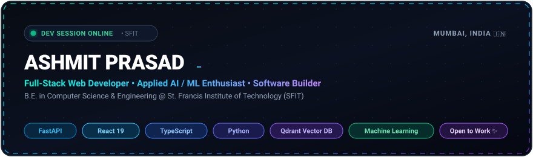
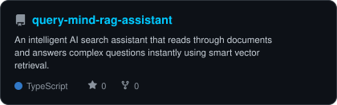
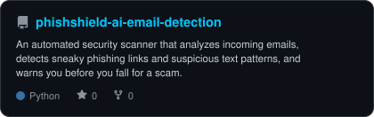
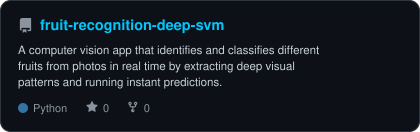
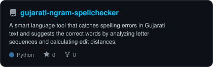
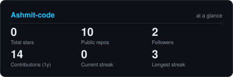

<div align="center">

  <!-- Animated Hero Banner -->
  <picture>
    
  </picture>

</div>

---

<div align="center">
  <h2>🚀 DEVELOPER MISSION CONTROL</h2>
</div>

```bash
ashmit@sfit-node:~$ ./init_session --user visitor
[SYSTEM ONLINE] Connecting to Ashmit Prasad's Developer Hub...

❯ IDENTITY:     Ashmit Prasad • Full-Stack Web Developer & Applied AI/ML Engineer
❯ EDUCATION:    B.E. in Computer Science & Engineering @ St. Francis Institute of Technology (SFIT), Mumbai
❯ PASSION:      Engineering intelligent RAG systems, NLP tools & high-performance web applications
❯ SPECIALTY:    FastAPI, React 19, TypeScript, Python, Qdrant Vector Cloud
❯ LOCATION:     Mumbai, India 🇮🇳
❯ STATUS:       Open for Software Engineering Internships & Technical Collaborations
```

---

<div align="center">
  <h2>🛠️ TECH STACK & TOOLKIT</h2>
</div>

<table align="center" width="100%">
  <tr>
    <td align="left" width="22%"><strong>Languages</strong></td>
    <td>
      
      
      
      
      
      
      
    </td>
  </tr>
  <tr>
    <td align="left"><strong>Frontend</strong></td>
    <td>
      
      
      
      
    </td>
  </tr>
  <tr>
    <td align="left"><strong>Backend & APIs</strong></td>
    <td>
      
      
      
      
      
    </td>
  </tr>
  <tr>
    <td align="left"><strong>AI, ML & NLP</strong></td>
    <td>
      
      
      
      
      
      
    </td>
  </tr>
  <tr>
    <td align="left"><strong>Databases & Tools</strong></td>
    <td>
      
      
      
      
      
      
    </td>
  </tr>
</table>

---

<div align="center">
  <h2>🧠 FEATURED PROJECTS</h2>
</div>

<table align="center" width="100%" style="border-collapse: collapse; border: none;">
  <tr>
    <td width="50%" align="center" style="border: none; padding: 10px;">
      <a href="https://github.com/Ashmit-code/query-mind-rag-assistant">
        <picture>
          <source media="(prefers-color-scheme: dark)" srcset="assets/card-query-mind-rag-assistant-dark.svg">
          <source media="(prefers-color-scheme: light)" srcset="assets/card-query-mind-rag-assistant-light.svg">
          
        </picture>
      </a>
    </td>
    <td width="50%" align="center" style="border: none; padding: 10px;">
      <a href="https://github.com/Ashmit-code/phishshield-ai-email-detection">
        <picture>
          <source media="(prefers-color-scheme: dark)" srcset="assets/card-phishshield-ai-email-detection-dark.svg">
          <source media="(prefers-color-scheme: light)" srcset="assets/card-phishshield-ai-email-detection-light.svg">
          
        </picture>
      </a>
    </td>
  </tr>
  <tr>
    <td width="50%" align="center" style="border: none; padding: 10px;">
      <a href="https://github.com/Ashmit-code/fruit-recognition-deep-svm">
        <picture>
          <source media="(prefers-color-scheme: dark)" srcset="assets/card-fruit-recognition-deep-svm-dark.svg">
          <source media="(prefers-color-scheme: light)" srcset="assets/card-fruit-recognition-deep-svm-light.svg">
          
        </picture>
      </a>
    </td>
    <td width="50%" align="center" style="border: none; padding: 10px;">
      <a href="https://github.com/Ashmit-code/gujarati-ngram-spellchecker">
        <picture>
          <source media="(prefers-color-scheme: dark)" srcset="assets/card-gujarati-ngram-spellchecker-dark.svg">
          <source media="(prefers-color-scheme: light)" srcset="assets/card-gujarati-ngram-spellchecker-light.svg">
          
        </picture>
      </a>
    </td>
  </tr>
</table>

<div align="center">
  <p>
    👉 <em>Explore all repositories on <a href="https://github.com/Ashmit-code?tab=repositories">GitHub Repositories</a></em>
  </p>
</div>

---

<div align="center">
  <h2>📊 ANALYTICS</h2>
  
  <br>

  <!-- At a glance stat card -->
  <picture>
    <source media="(prefers-color-scheme: dark)" srcset="assets/card-stats-dark.svg">
    <source media="(prefers-color-scheme: light)" srcset="assets/card-stats-light.svg">
    
  </picture>

  <br><br>

  <!-- Language mix spider / radar chart -->
  <picture>
    <source media="(prefers-color-scheme: dark)" srcset="assets/radar-langs-dark.svg">
    <source media="(prefers-color-scheme: light)" srcset="assets/radar-langs-light.svg">
    
  </picture>

</div>

---


---

<div align="center">
  <h2>📬 GET IN TOUCH</h2>

  <p>I'm always keen to discuss software engineering roles, open-source projects, or new tech ideas.</p>

  <a href="https://github.com/Ashmit-code">
    
  </a>
  &nbsp;
  <a href="https://www.linkedin.com/in/">
    
  </a>
  &nbsp;
  <a href="mailto:ashmitprasad@gmail.com">
    
  </a>

  <br><br>
  <sub>Engineered with precision • © Ashmit Prasad</sub>

</div>
